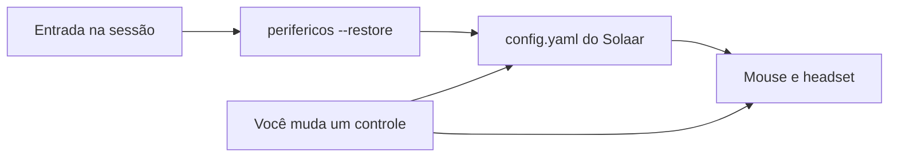

# Periféricos

Aplicativo visual para Linux que configura periféricos de qualquer marca. O nome de cada aparelho vem do próprio dispositivo. Mouse e headset com HID++ usam a mesma conversa do Solaar; o áudio USB entra pelo mixer da placa, sem nome de fabricante fixo.

<p align="center">
  
</p>

## Para quais sistemas

| Sistema | Situação |
| --- | --- |
| Ubuntu 24.04 ou mais novo, com GNOME | O caminho testado neste projeto |
| Debian, Fedora, Arch e derivados | Funciona com GTK 4, libadwaita e Solaar instalados |
| Outras sessões Linux (KDE, Xfce, Sway) | A janela abre se o sistema tiver GTK 4 e libadwaita |
| Windows e macOS | Não. O acesso ao receptor usa hidraw e as regras udev do Linux |

O programa não traz um driver novo. Ele usa a biblioteca do [Solaar](https://github.com/pwr-solaar/Solaar) que já está na máquina.

## Por que usar no lugar do Solaar

O Solaar continua sendo o motor. A diferença é a forma de usar.

| | Solaar | Periféricos |
| --- | --- | --- |
| Janela | Painel GTK 3 genérico, em inglês, com dezenas de opções misturadas | Tela em português só do que o mouse e o headset expõem |
| PRO X2 SUPERSTRIKE | DPI, taxa e botões analógicos existem, mas ficam no meio do resto | DPI de 100 a 44000, taxa em Hz, atuação, rapid trigger e háptico num cartão só |
| PRO X 2 LIGHTSPEED | Ajustes de áudio no mesmo painel de qualquer outro aparelho | Retorno do microfone, equalizador, realce e desligamento quando o headset liga |
| Dois programas ao mesmo tempo | Disputa o receptor com qualquer outro cliente HID++ | Avisa e oferece fechar o Solaar para um não sobrescrever o outro |
| Ao entrar no sistema | Dá para deixar o Solaar residente, sem uma tela pensada para restaurar | Um interruptor grava o início automático e, na entrada, reaplica o que foi salvo |
| Onde a configuração fica | `~/.config/solaar/config.yaml` e na memória do aparelho | No mesmo arquivo, mais a preferência do app em `~/.config/perifericos/config.yaml` |

Cada mudança de DPI, taxa, botão ou áudio é gravada na hora. Não existe botão de salvar separado: o valor vai para o aparelho e para o arquivo do usuário.

## Instalação

<details open>
<summary>Ubuntu e Debian</summary>

```bash
sudo apt install python3-gi python3-gi-cairo python3-venv gir1.2-gtk-4.0 gir1.2-adw-1 python3-yaml
pipx install solaar
git clone git@github.com:gustavo-messias-silva/meus-perifericos.git
cd meus-perifericos
./install.sh
```

Abra **Periféricos** no menu ou rode `perifericos`.

</details>

<details>
<summary>Fedora</summary>

```bash
sudo dnf install python3-gobject gtk4 libadwaita python3-pyyaml
pipx install solaar
git clone git@github.com:gustavo-messias-silva/meus-perifericos.git
cd meus-perifericos
./install.sh
```

</details>

<details>
<summary>Arch Linux</summary>

```bash
sudo pacman -S python-gobject gtk4 libadwaita python-yaml
pipx install solaar
git clone git@github.com:gustavo-messias-silva/meus-perifericos.git
cd meus-perifericos
./install.sh
```

</details>

O `install.sh` cria um ambiente em `~/.local/share/perifericos/venv`, o atalho e o ícone do seu usuário. Não pede senha de root. O acesso ao receptor continua sendo o das regras udev que o Solaar já instalou. Se o app disser que falta permissão, replugue o receptor depois de instalar o Solaar.

## Iniciar com o sistema e manter a configuração

1. Abra o Periféricos e ajuste o mouse ou o headset. O valor novo já fica salvo.
2. No botão de menu da barra, ligue **Iniciar com o sistema**.
3. Na próxima entrada na sessão, o atalho `~/.config/autostart/perifericos.desktop` executa `perifericos --restore`.
4. O `--restore` abre a janela e empurra de volta o que está em `~/.config/solaar/config.yaml` para cada aparelho que estiver ligado.



**Reaplicar configurações salvas**, no mesmo menu, faz isso sem esperar o próximo login. Desligar o interruptor apaga só o atalho de início. Não apaga DPI, taxa nem áudio.

<details>
<summary>Onde cada coisa é gravada</summary>

| Arquivo | Conteúdo |
| --- | --- |
| `~/.config/solaar/config.yaml` | DPI, taxa, botões, equalizador e o restante de cada aparelho |
| `~/.config/perifericos/config.yaml` | Se o app inicia com a sessão |
| `~/.config/autostart/perifericos.desktop` | Atalho usado pelo GNOME, KDE e outros que seguem o autostart do FreeDesktop |

</details>

## O que a janela controla

No **PRO X2 SUPERSTRIKE**, com ele ligado no Bolt: bateria, perfis internos, taxa de atualização, DPI dos dois eixos, altura do sensor, atuação, rapid trigger e háptico dos botões. Com os eixos iguais, um controle de DPI vale para os dois.

No **PRO X 2 LIGHTSPEED**, a página avisa enquanto ele está desligado. Ligado, entram retorno do microfone, realce, equalizador e desligamento automático, conforme o que o headset informar.

## Licença

GPL-2.0 ou posterior, a mesma família do Solaar, porque o app importa essa biblioteca.
